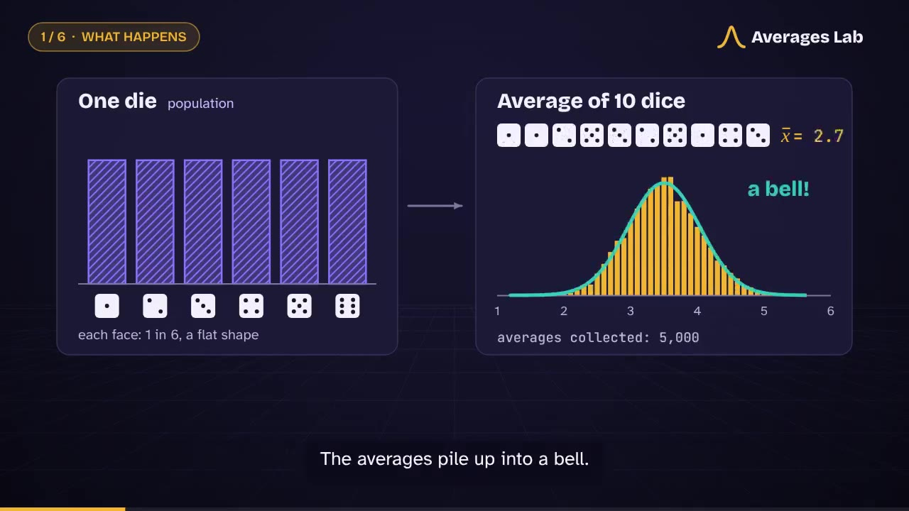

# Central Limit Theorem, Explained

**Averages Lab** is a free, browser-based teaching resource on the Central Limit Theorem (CLT). It combines a live 3D simulation, a guided tutorial, six "What if?" prediction challenges and a narrated 90-second video. Explanations can be switched between high-school, bachelor's and master's level.

**Live site:** https://rajan56.github.io/CentralLimitTheorem-Explained/



## What is inside

| Part | What the learner does |
|---|---|
| Tutorial (7 steps) | Learns population, sample, sample mean, sampling distribution, standard deviation and standard error, each with a "Show me" button that drives the lab. |
| 3D lab | Picks a population, sample size *n*, number of samples, speed and random seed. Raw values rise out of the population wall, merge into a golden bead (the sample mean) and drop into the histogram of means, where the normal curve N(μ, σ/√n) is drawn for comparison. |
| Flat charts and live numbers | Exact 2D charts plus μ, σ, σ/√n, mean and SD of the simulated means, their ratio, skewness, IQR and the share of means within μ ± 1.96·SE. A plain-language reading of the result updates as the simulation runs. |
| Challenges | Six predict-then-test experiments: bigger *n*, more repetitions, skewed data, a two-peaked population, rare yes/no events and the Cauchy distribution, where the CLT fails. |
| Background sections | Why the theorem works, CLT vs. Law of Large Numbers, assumptions, history from de Moivre (1733) to Lindeberg and Feller, uses in academic and industrial research, formal statements for master's students, glossary. |
| Video | 90-second narrated video with burned-in captions, a separate MP3 narration, WebVTT captions and the timestamped script. |
| Achievements | Ten badges that reward learning steps (finishing the tutorial, taming skew, breaking the theorem), saved in the browser. |

Populations available in the lab: uniform, normal, highly skewed (exponential waiting times), Bernoulli yes/no with adjustable *p*, fair die, bimodal, a custom population you draw with the mouse or keyboard, and Cauchy (infinite variance).

## Run it locally

No build step and no dependencies to install. The page uses ES modules, so it needs to be served over HTTP rather than opened as a file:

```bash
git clone https://github.com/Rajan56/CentralLimitTheorem-Explained.git
cd CentralLimitTheorem-Explained
python3 -m http.server 8000
# open http://localhost:8000
```

Any static server works (`npx serve`, VS Code Live Server, and so on).

## Publish with GitHub Pages

The site is plain static files at the repository root, so GitHub Pages serves it directly:

1. Repository **Settings → Pages**.
2. Source: **Deploy from a branch**, branch `main`, folder `/ (root)`.
3. Save. The site appears at `https://<user>.github.io/CentralLimitTheorem-Explained/` within a minute or two.

## Using the simulation

- **Run / Pause** (`Space`), **Step** (`S`) to draw a single sample slowly, **Reset** (`R`).
- **Speed:** *Watch* animates every value of every sample; *Turbo* collects thousands of means in seconds.
- **Random seed:** the same seed always reproduces the same experiment. "Run again" after a finished run picks a new seed so learners see fresh randomness.
- **Zoom the means axis** to inspect the shape when *n* is large; leave it off to see how the means narrow compared with the population.
- **3D view:** drag to rotate, scroll or pinch to zoom, or use the Angle / Front / Top buttons. The 2D charts below always show the same data for readers who prefer them or cannot use WebGL.

Accessibility: keyboard-operable controls, visible focus, charts that use pattern and line style as well as colour (hatched population, solid bars for means, dashed line for the normal curve), live text descriptions of each chart, and support for reduced-motion and dark-mode preferences.

## The video

| File | Contents |
|---|---|
| [`video/clt-explained-90s.mp4`](video/clt-explained-90s.mp4) | 1280×720, 30 fps, H.264 + AAC, exactly 90.0 s, captions burned in |
| [`video/clt-narration.mp3`](video/clt-narration.mp3) | Narration only |
| [`video/clt-captions.vtt`](video/clt-captions.vtt) | WebVTT captions |
| [`video/narration-script.md`](video/narration-script.md) | Script with timestamps and on-screen notes |

On the live site, the **Download video (MP4)** button in the video section saves the file. To recreate or edit the video, see [`video-source/README.md`](video-source/README.md).

## Accuracy notes

- The lab states the theorem for independent, identically distributed observations with finite variance and shows that "large enough *n*" depends on the population; it does not teach a universal *n* ≥ 30 rule.
- Population means and standard deviations shown in the lab are exact values, not estimates.
- The Cauchy option is included on purpose, to show what happens when the finite-variance assumption fails.

## Project structure

```
index.html            page content and structure
src/style.css         design (light and dark themes)
src/app.js            controls, simulation loop, tutorial, challenges, achievements
src/dist.js           populations, seeded random numbers, statistics
src/charts.js         2D charts
src/scene3d.js        three.js 3D scene
vendor/               three.js r160 (MIT) and self-hosted fonts (SIL OFL)
video/                finished video, narration, captions, script, poster
video-source/         everything needed to regenerate the video
```

## Credits

- 3D rendering: [three.js](https://threejs.org/) (MIT licence).
- Fonts: Bricolage Grotesque, Atkinson Hyperlegible, JetBrains Mono (SIL Open Font Licence).
- Narration voice: [Kokoro-82M](https://huggingface.co/hexgrad/Kokoro-82M) (Apache 2.0), run locally through [kokoro-onnx](https://github.com/thewh1teagle/kokoro-onnx). No music is used.
